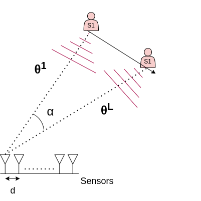
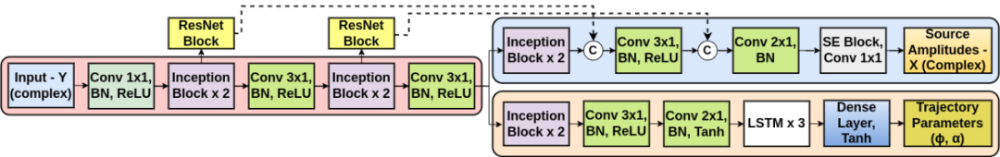
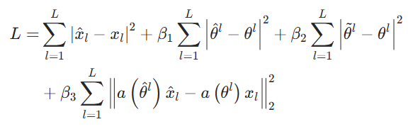
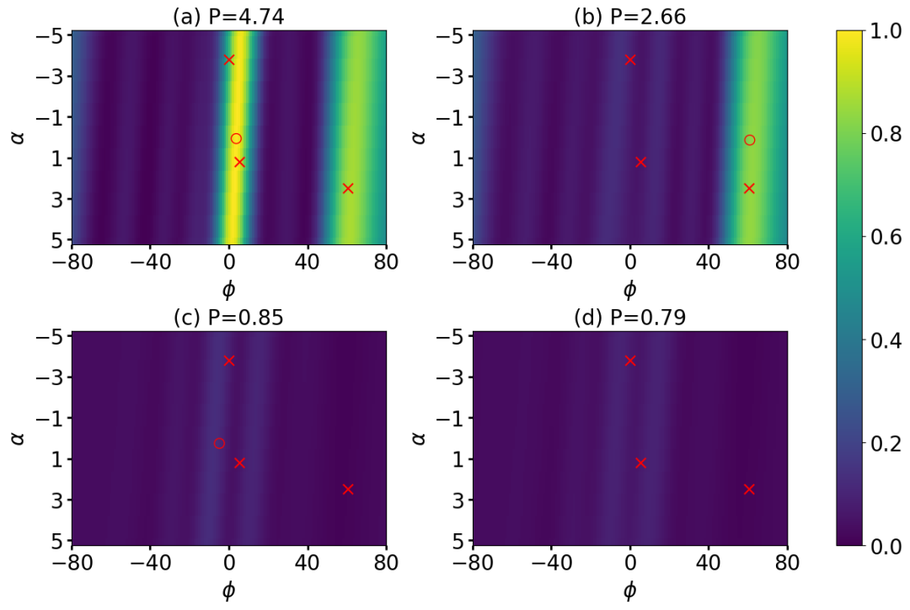
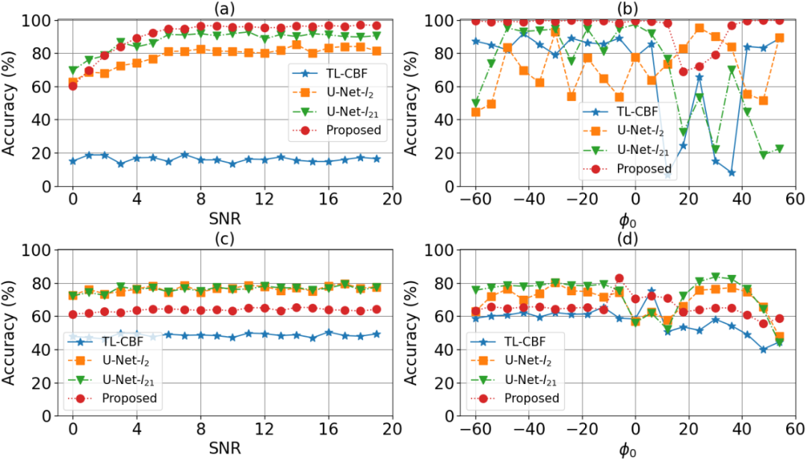
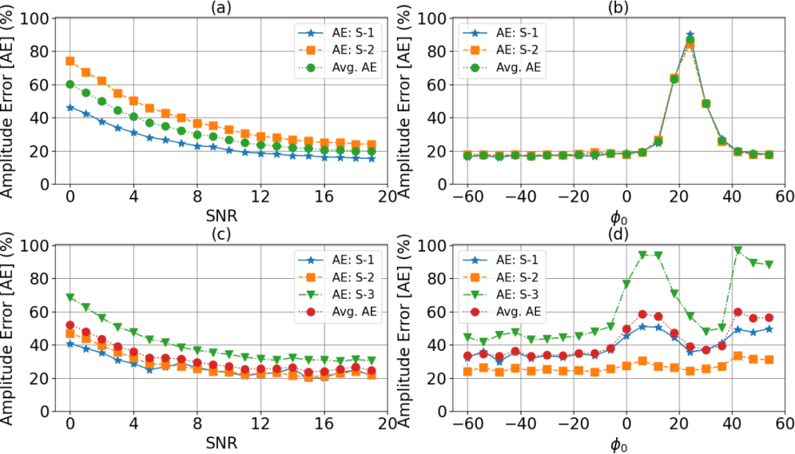

# [Meshless DOA]Using Deep Complex Networks and Residual Signal for Ordered DOA Trajectory Estimation[with Python Code]

II. Abstract: This paper proposes a data-driven direction of arrival (DOA) trajectory estimation method. The method employs a deep convolutional network architecture to utilize complex numbers to capture amplitude and phase information from the received sensor array data. The network design is designed to output parameters for the DOA trajectory of the strongest sound source and its amplitude. Unlike traditional methods that attempt to estimate all sound source parameters simultaneously (which can lead to ambiguity in allocation and uncertainties in output dimensions), this paper adopts a sequential approach: subtracting the estimated sound source signal contribution from the input to obtain residual signals, which are then fed back into the network to identify secondary strong sources, and so on, making the proposed network reusable. The network was evaluated on different complexity of simulated data, and the results verified the feasibility of the reusable network, with potential directions for further exploration in the future.
III. Introduction: DoA estimation refers to the technique of estimating the direction of multiple sound sources from an array of sensors [1]. In many scenarios, sound sources are often in motion, causing changes in DOA over consecutive frames. To address this issue, researchers have proposed DOA trajectory models in recent years [2,3] — instead of assuming the sound source is stationary, they model the dynamic changes in sound source DOA through linear [2] and nonlinear trajectories [3], and recover DOA by estimating trajectory parameters, known as trajectory localization.
To estimate the trajectory parameters of DOA, researchers have developed variants of traditional beamforming (CBF) [1] and sparse Bayesian learning [4] related methods [2]. Literature [6] proposes a U-Net based on deep learning architecture that converts low-resolution CBF outputs into sharp spectral representations. However, most such methods have limitations due to parameter estimation based on grids, limiting the estimation resolution; whereas gridless methods [3] use model-based sparse signal representations to sequentially identify sound source parameters.
The research objective of this paper is to develop data-driven methods that are grid-free and reusable. A deep residual network [7] is designed to estimate the grid-free DOA trajectory parameters, outputting the amplitude (at each snapshot) of the complex signal for a single source (the strongest source) and the trajectory parameters. By removing the contribution of the estimated source from the input data, a residual signal is obtained, which is then input into the same network to iteratively identify additional sources until the preset stopping criterion is met. This method avoids the allocation problem and eliminates the troublesome issue of uncertain output dimensions, addressing the common challenge of estimating multiple sources simultaneously. Its concept of reusability stems from residual-based processing techniques, which are widely applied in greedy algorithms such as Matching Pursuit (MP) [8,9]. To the author's knowledge, no such reusable networks have been proposed in the literature [10].
IV. Method Overview (I) Network Architecture: The recurrent network [7,11,12] can directly process complex input without the need to split it into real and imaginary parts, offering significant advantages in scenarios where amplitude and phase interactions are crucial [13-18]. The proposed deep recurrent network is used to estimate the amplitude (complex number) and DOA trajectory parameters (real number), differing from U-Net in that it does not rely on trajectory parameter grids and is an ungridded method. For a given input, the network extracts only the parameters of a single source (the strongest one) and achieves reusability by subtracting the contribution of the extracted source from the modified input.
The overall network architecture consists of three core components (see Figure 1):
1  
Feature extractor (Pink shadow): Processes the input complex numerical matrix Y, outputs complex numerical features, and serves as an input for the subsequent two estimators.
2  
Amplitude Estimator (blue shadow): Used to estimate the amplitude X of the sound source.
3  
Trajectory Estimator (Pink Shadow): Used to estimate trajectory parameters (φ, α).
Key Components Description:
•  
Complex Valued Convolutional Block: The convolution kernel W = A + iB (A, B are real-valued matrices), the input feature H = P + iQ, the convolution operation is defined as WH = (AP - BQ) + i(AQ + B*P) (* denotes convolution operation).
•  
Basic Building Blocks: Each convolutional block sequentially performs complex number convolution, complex number batch normalization (BN), and activation functions (ReLU for the convolutional block, Tanh before the LSTM block and after the fully connected layer);
Functional Modules: Inception blocks are used to parallelly capture and process multi-scale (receptive field size) information, ResNet blocks are used to process and downsample features outputted by the Inception blocks, Squeeze-and-Excitation (SE) blocks are used to convert channel features into attention weights to focus on important features, and LSTM layers [22] are used to implement sequential processing of L snapshots.
The total number of parameters in the network is 548,152, with all blocks using complex number weights except for the LSTM and fully connected layers in the trajectory estimator.
(II) Loss Function Network Training uses the following loss function:
In which:
•  
and are the true amplitude (complex number) and normalized DOA of the strongest sound source (with the highest energy, i.e., maximum) in the lth snapshot;
•  
is the amplitude estimate output, is the DOA calculated by the trajectory estimator output (), is the DOA estimate value from the LSTM output;
•  
•  
•  
are the weights of each loss term (set as 1 in this paper, which can be further optimized later);
•  
the first two terms are basic training losses, and the last two terms are used to accelerate convergence: the third item ensures that the LSTM output aligns with the true trajectory to improve accuracy, and the fourth item jointly considers the errors of amplitude and trajectory parameters to promote mutual influence and coordination between the weight of the two estimators.
(III) Continuous Estimation Network Reuse Mechanism The input matrix implicitly contains all sound source amplitudes and corresponding DOA trajectories (k=1,...,K). The network first outputs the sound source parameters and (), through the following formula to calculate the residual signal:
In which is the direction matrix,. The residual signal is input into the same network to estimate the next sound source and obtain a new residual signal. This process can stop when the expected number of sound sources or the residual signal energy reaches the noise energy level.
V. Conclusion This paper makes two main contributions to the DOA trajectory estimation problem: Firstly, it proposes a deep recurrent network for ungridded estimation of source amplitude and trajectory parameters; Secondly, design a network structure that estimates only the parameters of individual (strongest) sound sources, making it reusable and supporting sequential sound source estimation. The simulation results show that the proposed method can estimate multiple sound sources. Future improvements can be made by optimizing network architecture or training strategies to mitigate the impact of error propagation, thereby enhancing estimation accuracy in such scenarios.
End

## Images

<!-- PAYMENT_BLOCK -->

## Get this dataset

- Payment link (Stripe): [Buy now](https://buy.stripe.com/3cs8yP7sY87d0vu9AB)
- Payment QR code: 

<!-- /PAYMENT_BLOCK -->
